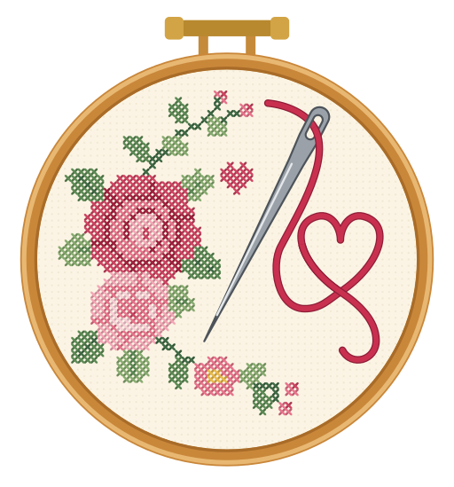

# Cross Stitch Studio

A cross stitch pattern designer that runs in the browser and installs on Android phones and tablets.

**Open the app: https://arte100.github.io/Cross-Stitch-Studio/**

No account and no download are needed. It works on phones, tablets and computers.

- Aida fabric in 11, 14, 16, 18, 20 and 22 count
- 489 DMC stranded cotton shades (screen colours are approximations)
- 237 example designs in ten groups
- Photo to pattern converter, and Trace a photo for stitching over a picture by hand
- Cross Stitch it: tick stitches off as you sew, with a count of what is done and what is left
- Save as an image with or without the grid, and save a printable pattern with the finished picture, a thread key and charts
- Backup files to keep or send a design
- Six colour themes

## Files

- `index.html` is the whole app
- `manifest.webmanifest` and the icon files make it installable
- `test/index.html` is a test copy, where changes are tried before they reach the app
- `sw.js` lets it open without an internet connection

## Install on Android

Open https://arte100.github.io/Cross-Stitch-Studio/ in Chrome, open the Chrome menu and choose "Add to Home screen" or "Install app". On some tablets the option is under "Save and share".

## Contributing

Ideas, bug reports and improvements are welcome. Open an issue to describe a problem or a suggestion, or send a pull request with your change.

## Licence

Copyright (C) 2026 Arturas Gulevskis

This program is free software. You can redistribute it and modify it under the terms of the GNU General Public License, version 2, as published by the Free Software Foundation. It comes with no warranty. The full text is in the `LICENSE` file.

The example designs are original drawings made for this project. They show everyday subjects, with no characters, logos or artwork taken from anyone else, and they are covered by the same licence.

DMC is a trademark of its owner. This project is not affiliated with or endorsed by DMC.
